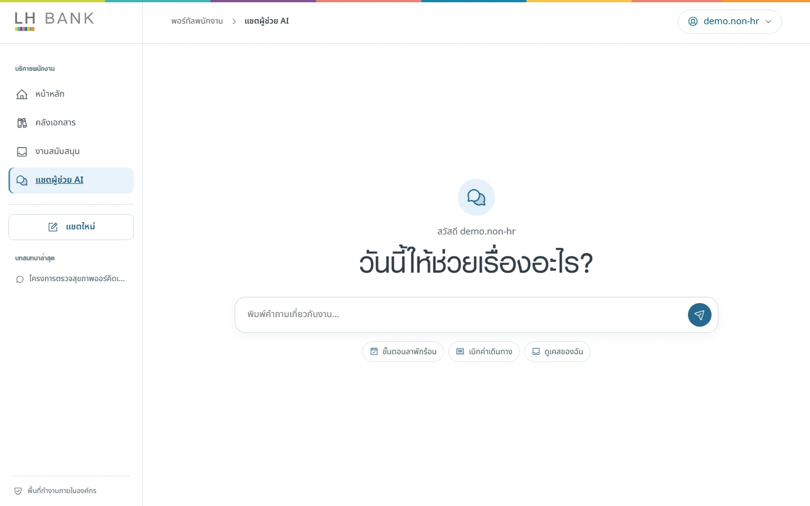

# คู่มือแชตและหน้าผู้ดูแล / Chat and admin guide

## ตั้งค่าคลังองค์กร / Set up company knowledge

1. เปิด **จัดการผู้ช่วย → เชื่อม AI / Connect** เพิ่มการเชื่อมต่อสำหรับ **ค้นเนื้อหาในเอกสาร / Document search** และ **เขียนและตอบคำถาม / Chat** เลือกผู้ให้บริการ ใส่ชื่อรุ่นและ API key จากนั้นกด **บันทึก → ทดสอบ → เลือกใช้** สำหรับแต่ละงาน ในระบบที่ตั้งค่าโมเดลไว้แล้ว ใช้ค่าเริ่มต้นของระบบได้
2. เลือก **เพิ่มเอกสาร / Add files** ระบุชื่อและเจ้าของเอกสาร เลือกผู้ที่เห็นได้ แล้วกด **เผยแพร่ให้ผู้ที่เลือก / Publish to readers** สิทธิ์เป็นแบบรวม ผู้ที่ตรงกับบทบาท แผนก หรือรายชื่ออย่างใดอย่างหนึ่งจะอ่านได้ หากเอกสารสำหรับ HR เท่านั้น ให้เลือกแค่แผนก HR แล้วรอ **ถามในแชตได้แล้ว / Ready**
3. เลือก **ลองถาม / Test chat** เพื่อเปิดแชตของบัญชีปัจจุบัน เมื่อตรวจรับสิทธิ์ให้เปิดบัญชีพนักงานจริงของแต่ละกลุ่มแยกโปรไฟล์ แล้วถามคำถามเดียวกัน ตรวจทั้งแหล่งอ้างอิงและคลังเอกสาร [วิธีเปิดบัญชี HR และนอก HR](../README.md)

In Admin, connect a document search model and a chat model. Save, test and activate each connection. Upload a file, choose its readers and wait for **Ready**. Access applies in both the library and chat. Test with the intended employee accounts. The admin's own chat uses the admin's document permissions.

## ใช้แชต / Use chat

เปิด **แชตใหม่** แล้วเลือกงานใต้ **ถามจากข้อมูลในระบบ** เพื่อค้นระเบียบหรือติดตามเคสของตนเอง หรือเลือก **ลองกับไฟล์ตัวอย่าง** เพื่อใช้ Excel ยอดขายไตรมาส 1, PDF กำหนดการอบรม หรือ TXT บันทึกส่งต่องาน ระบบเตรียมคำถามให้แก้ก่อนส่ง เมื่อแนบไฟล์แล้วกดชื่อไฟล์เพื่อดูตัวอย่าง ใช้ Enter เพื่อส่ง หรือ Shift+Enter เพื่อขึ้นบรรทัดใหม่ ไฟล์ของตนเองใช้ปุ่ม **แนบไฟล์** หรือลากมาวางในช่องข้อความได้

พิมพ์ **ดูเคสของฉัน** เพื่อดูจำนวนตามสถานะและเปิดเคสล่าสุดได้จากแชต ปุ่ม **ติดตามรายการ** ในคำตอบส่งต่อจะเปิดเคสนั้นโดยตรง หากเจ้าหน้าที่บันทึกผลแล้ว ให้ถาม **เรื่องนี้ได้ผลหรือยัง** ในบทสนทนาเดิมเพื่ออ่านผลล่าสุดพร้อมที่มาในระบบงาน

ตัวอย่าง Excel แสดงยอดรวม กราฟ และการ์ด PowerPoint ในบทสนทนา กด **ดูตารางข้อมูล** เพื่อขยายตัวเลขรายเดือน กดชื่อไฟล์ PowerPoint เพื่อดูตัวอย่างแต่ละสไลด์หรือใช้ปุ่มดาวน์โหลด



| ต้องการทำอะไร / Goal | วิธีใช้ / Action |
|---|---|
| ถามนโยบาย / Ask about policy | เปิด **ถามผู้ช่วย / Ask** เช่น “ลาพักร้อนต้องยื่นล่วงหน้ากี่วัน” เปิดที่มาเพื่อตรวจเอกสารและตำแหน่งอ้างอิง |
| อ่านไฟล์ส่วนตัว / Read a file | เลือก **แนบไฟล์ / Attach** แล้วถามคำที่อยู่ในไฟล์ กดชื่อไฟล์ก่อนหรือหลังส่งเพื่อดูตัวอย่าง ไฟล์แนบใช้ได้กับเจ้าของในแชตนั้น การเพิ่มเข้าคลังองค์กรทำผ่านหน้า Admin |
| ดูตารางและกราฟ / Explore data | แนบ CSV หรือ XLSX ที่มีหัวตารางไม่ซ้ำ พิมพ์ **แสดงตาราง** เลือกคอลัมน์ตัวเลขที่ต้องการดูในกราฟ ตารางเลื่อนได้และส่งออกข้อมูลครบทุกแถว |
| คำนวณ / Calculate | พิมพ์ **คำนวณ (1200 + 300) / 3** หรือพิมพ์ `คำนวณ sum(col("Sales"))` กับตารางที่แนบ รองรับ sum, mean, min, max, count และ round |
| เขียนเอกสาร / Draft | พิมพ์ “ร่างอีเมล” แล้วระบุผู้รับ จุดประสงค์และเนื้อหา เช่น “ร่างอีเมลภาษาไทยเชิญทีมประชุมวันจันทร์” ข้อความทยอยแสดงขณะโมเดลเขียน กด **หยุด / Stop** เพื่อหยุดรับข้อความ ร่างต่อจากร่างก่อนหน้าได้ |
| ตรวจเคส / Check cases | พิมพ์ “ดูเคสของฉัน” ระบบตรวจรายการที่บัญชีนั้นอ่านได้ |
| ส่งออก / Download | ใต้คำตอบเลือก PDF, Word (.docx), PowerPoint (.pptx), Excel (.xlsx), CSV หรือ Markdown แล้วกด **ดาวน์โหลด / Download** หรือพิมพ์ “ส่งออกเป็น PDF” ต่อจากคำตอบในโหมด Ask |

### รายงานจาก Excel ในข้อความเดียว / One-turn spreadsheet report

ในโหมด **ถามผู้ช่วย / Ask** แนบ Excel แล้วพิมพ์ “ช่วยสรุปยอดขาย ทำกราฟ แล้วทำเป็น PowerPoint ให้หน่อย” แชตจะแสดงยอดรวม กราฟ และปุ่ม **ดาวน์โหลด PowerPoint** โมเดลที่เลือกใน Admin ได้รับคำขอกับชื่อและชนิดคอลัมน์เพื่อเลือกเครื่องมือ การรวมยอดและการสร้างไฟล์เกิดขึ้นบนเซิร์ฟเวอร์ของพอร์ทัล ถ้ายังไม่ได้เชื่อมโมเดล ระบบใช้กฎสำหรับคำขอที่ชัดเจน และแสดงวิธีที่ใช้ใน **ที่มาและขั้นตอน**

รายงานใช้ข้อมูลชีตแรกและคอลัมน์ตัวเลขหนึ่งคอลัมน์ โดยรวมตามกลุ่ม เช่น เดือน ตัวเลขติดลบหักจากยอดรวม ระบบข้ามยอดว่างและแถวที่มีป้ายรวมที่รู้จัก เช่น “รวม” และ “Grand total” สำหรับเซลล์สูตร ให้บันทึกไฟล์จาก Excel ที่คำนวณค่าแล้ว กราฟแสดงกลุ่มตามลำดับที่พบสูงสุด 20 กลุ่ม ยอดรวมครอบคลุมทุกกลุ่ม สไลด์มีกราฟ PowerPoint ที่แก้ไขได้ และดาวน์โหลดภายใต้สิทธิ์ของบทสนทนาเดิม

**ทดสอบผ่าน HTTP API** หลังตั้งค่าบัญชีสาธิต HR ให้รันจากเครื่องที่ติดตั้ง dependencies ของโปรเจกต์แล้ว

```shell
python scripts/test_sales_report_api.py
```

สคริปต์สร้าง Excel ตัวอย่าง ส่งไฟล์ด้วย `POST /api/conversations/{id}/attachments` และส่งคำถามเพียงครั้งเดียวด้วย `POST /api/conversations/{id}/stream` โดยระบุ `turn_id`, `attachment_id` และ `question` ผลลัพธ์มี `planner`, `selected_tools`, `summary`, `chart` และ `artifact.url` สคริปต์ดาวน์โหลดไฟล์ผ่าน URL นั้น เปิดอ่านค่าของกราฟใน PowerPoint แล้วเทียบกับยอดคาดหมาย เก็บ Excel, PowerPoint และผลตรวจ `receipt.json` ใน `var/sales-report-demo/`

การทดสอบปกติต้องได้ `planner=model` หากต้องการทดสอบพอร์ทัลที่ยังไม่มีโมเดล ให้ใช้ `--expect-planner built_in` สำหรับระบบอื่นให้กำหนด bearer token พนักงานในตัวแปรสภาพแวดล้อม `DESK_TEST_TOKEN` และส่ง `--base-url` ของระบบที่ต้องการทดสอบ

**ตัวอย่างไฟล์** Excel และ CSV แสดงสูงสุด 25 แถว PDF ที่แนบใหม่แสดงภาพหน้าแรกและข้อความที่อ่านได้ ไฟล์ Office และไฟล์ข้อความแสดงข้อความที่สกัดได้ PowerPoint ที่ระบบสร้างเปิดดูข้อความ กราฟ และตารางทีละสไลด์ได้

**ไฟล์แนบ** รองรับ PDF, DOCX, PPTX, XLSX, TXT, Markdown และ CSV ขนาดสูงสุด 5 MiB ต่อไฟล์ เลือกใช้ครั้งละหนึ่งไฟล์ต่อข้อความ ตารางใช้ชีตแรก สูงสุด 500 แถวข้อมูลและ 16 คอลัมน์ กราฟแสดงได้ถึง 20 แถวแรก สไลด์แสดงตัวอย่างตารางถึง 30 แถว การคำนวณใช้ชุดสูตรที่กำหนดในกระบวนการแยกพร้อมจำกัดเวลา

**Privacy and processing.** Private attachments are scoped to the signed-in account, role and conversation. Document search and calculator tools can process an attachment without a chat provider. Choosing Draft sends the brief, up to 10,000 characters of extracted reference text and, for revisions, up to 4,000 characters of the preceding draft to the configured provider. The title feature sends the redacted opening question after the first successful reply. When naming is unavailable, the opening question is used as the title.

**ที่มาและขั้นตอน / Sources & steps** แสดงงานที่เกิดขึ้นจริง เช่น ตรวจสิทธิ์ ค้นเอกสาร หรือคำนวณ พร้อมที่มาและรหัสติดตาม คำตอบนโยบายจะแสดงหลังตรวจหลักฐานและสิทธิ์เสร็จ ร่างเอกสารแสดงข้อความจากโมเดลขณะเขียน ผู้ใช้ตรวจทานร่างก่อนนำไปเผยแพร่ได้
