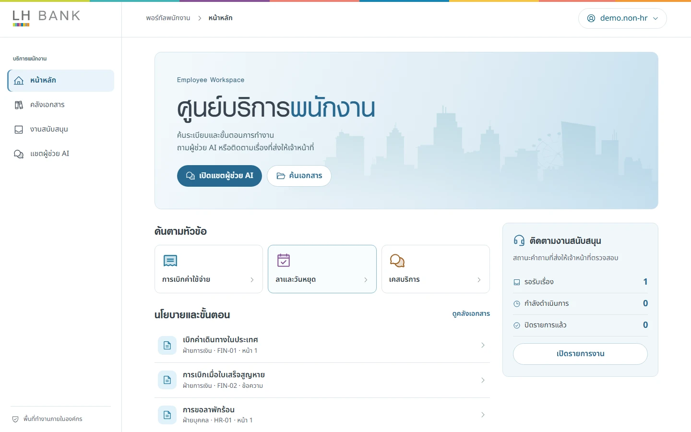

# พอร์ทัลความรู้พนักงาน

[หน้าแชตผู้ช่วย](portal-assistant.webp) · [หน้าจอบนโทรศัพท์](portal-mobile.webp) · [หน้าผู้ดูแล AI](portal-admin.webp)

## ภาษาภาพและการใช้งาน

แถบบริการด้านซ้ายมีหน้าหลัก คลังเอกสาร งานสนับสนุน และแชตผู้ช่วย AI บัญชี admin เห็นเมนูผู้ดูแล AI เพิ่มขึ้น บนโทรศัพท์ให้กดปุ่มเมนูข้างโลโก้ LH Bank ส่วนชื่อบัญชีอยู่ด้านขวาบนทุกหน้า

- **หน้าหลัก** เปิดเอกสารตามหัวข้อ ดูสรุปงานตามบัญชี หรือกดเปิดแชต
- **แชตผู้ช่วย AI** เปิดพื้นที่สนทนาเฉพาะ พิมพ์คำถามหรือเลือกคำถามที่ใช้บ่อย ตรวจหลักฐาน และติดตามรายการที่ส่งต่อ เมื่อเข้าสู่ระบบแล้วให้ใช้ **แชตใหม่** หรือเลือกบทสนทนาล่าสุดได้ในแถบซ้าย
- **คลังเอกสาร** ค้นรหัส ชื่อ เนื้อหา หรือเจ้าของเอกสาร กรองนโยบายกับแชตบนเซิร์ฟเวอร์ ระบบใช้สิทธิ์และรุ่นดัชนีก่อนแบ่งหน้า
- **งานสนับสนุน** พนักงานเห็นเคสของตัวเอง เจ้าหน้าที่เห็นคิวที่ตนรับผิดชอบ ผู้รับงานสามารถบันทึกผลหรือคืนงานให้เพื่อนรับต่อ การตรวจเจ้าของ การเปลี่ยนสถานะ และการเพิ่มประวัติเกิดในธุรกรรมเดียว
- **บัญชี** องค์กรใช้ Authorization Code พร้อม PKCE และ IdP เป็นผู้กำหนดกลุ่ม เครื่องที่ติดตั้งสามารถออกคำเชิญให้พนักงานรายบุคคล หน้าเว็บใช้ HttpOnly cookie และตรวจต้นทางสำหรับคำสั่งที่เปลี่ยนข้อมูล

- **แชตและผู้ดูแล AI** พนักงานเปิดประวัติ ถามต่อ และตรวจเคสจากแชต ผู้ดูแลแยกบัญชีเพื่อปรับเครื่องมือตรวจเคสและติดตามเหตุผลการตอบ [คู่มือและสิทธิ์](agent.md)

## หลักฐานตรวจรับ

ชุดทดสอบ Python ครอบคลุมการใช้คำเชิญซ้ำ อายุเซสชัน การเพิกถอน การเข้าถึงต่างสิทธิ์ การแข่งขันรับเคส และการตรวจ callback จากผู้ให้บริการตัวตนจำลองที่ลงลายเซ็นจริง ชุดทดสอบ Chromium ใช้ API, PostgreSQL, โมเดล และหน้าจอจริงบนฐานข้อมูลแยก รวมการรีเฟรช การแสดงหลักฐาน และการส่งคำตอบกลับถึงผู้ถาม [ชุดทดสอบพอร์ทัล](../tests/test_portal.py) · [ขั้นตอนตรวจหน้าจอ](../scripts/check_portal.py)

การทดสอบกับ IdP และเอกสารที่ได้รับอนุมัติของลูกค้าต้องทำในเครือข่ายลูกค้า เกณฑ์เวลา p95 และผลพีกของเครื่องส่งมอบอยู่ในรายงานความจุ [การตั้งค่าองค์กร](operations.md#การเชื่อมองค์กร) · [รายงานโหลด](../evaluation/capacity.md)

หลังติดตั้งรุ่นพอร์ทัล วันที่ 22 พฤศจิกายน 2026 ยิงคำถามที่ API 180 ครั้งด้วย 180 บัญชี ที่ 2 ครั้ง/วินาที คำตอบและเอกสารตรงเฉลย 180/180 ข้อ p95 รวม 2.20 วินาที แคช 108 ข้อมี p95 0.14 วินาที ส่วนคำถามใหม่ 72 ข้อมี p95 3.61 วินาที จึงพลาดเกณฑ์ 3 วินาทีสำหรับคำถามใหม่ รอบก่อนหน้านี้เครื่องส่งโหลดเข้าโหมดพักและยิงคำขอช้ากว่าแผนที่ p95 ถึง 806 วินาที จึงใช้รอบที่เปิดเครื่องต่อเนื่องในการประเมิน [ผลรอบที่วัด](../evaluation/portal-load.json) · [เวลารายคำขอ](../evaluation/portal-load.jsonl.gz)

## ทรัพยากรภาพ

เว็บเสิร์ฟทรัพยากรทั้งหมดจาก `/static/assets/` เพื่อให้เครื่องพนักงานโหลดหน้าได้ภายในเครือข่ายองค์กร

- โลโก้ ไอคอนแท็บ ภาพเส้นขอบฟ้า และฟอนต์หัวเรื่อง LH Bank Header มาจากเว็บไซต์ธนาคาร [หน้าอ้างอิง](https://www.lhbank.co.th/th/contact/contact-us/) · [โลโก้](https://www.lhbank.co.th/LH/media/Icon/logo-header.svg) · [ภาพเส้นขอบฟ้า](https://www.lhbank.co.th/LH/Assets/img/subheader_bg.png) · [สไตล์และที่มาฟอนต์](https://www.lhbank.co.th/LH/Assets/css/main.css)
- เนื้อหาแชต เอกสาร และช่องกรอกใช้ Noto Sans Thai เมนูใช้ Phosphor Icons รุ่น 2.1.1 แบบ Regular และ Duotone โดยรวมเฉพาะรูปที่พอร์ทัลใช้ไว้ใน SVG sprite [ใบอนุญาตฟอนต์](../static/assets/noto-license.txt) · [ใบอนุญาตไอคอน](../static/assets/phosphor-license.txt)
