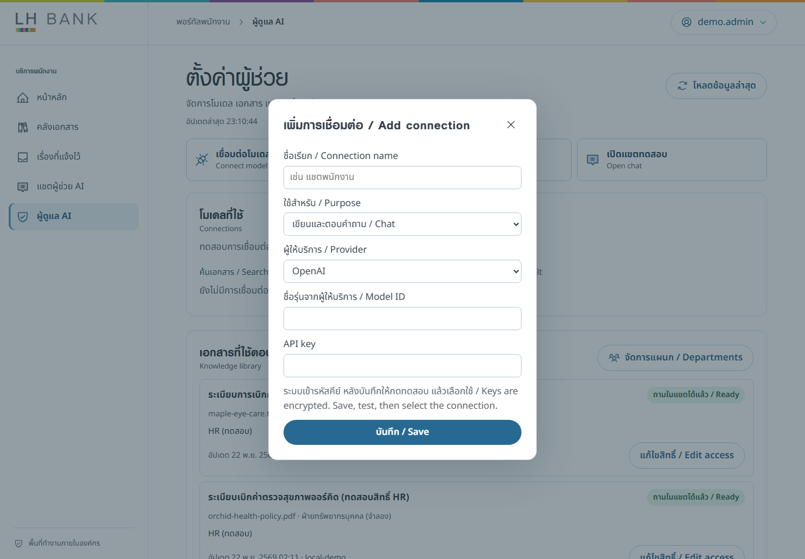

# ใช้งานผ่าน Model API

โหมดนี้เรียก API ของ gateway เดียวกันสำหรับสร้างเวกเตอร์และเลือกหลักฐาน พอร์ทัลใช้ PostgreSQL/pgvector, OCR และ worker จัดทำดัชนีในระบบเดิม การติดตั้งใหม่ข้ามขั้นตอนดาวน์โหลดน้ำหนักโมเดลได้ทั้งหมด การจัดทำดัชนีจะส่งข้อความเอกสารรวมถึงเอกสาร HR ไปที่ embedding endpoint ส่วนการตอบแชตจะส่งคำถามและเฉพาะหลักฐานที่ผู้ถามมีสิทธิ์ไปที่ chat endpoint ใช้ deployment ที่องค์กรอนุมัติให้ประมวลผลเอกสารประเภทนั้น

[คู่มือขั้นตอนตั้งค่า อัปโหลด และทดสอบแชต](chat-workspace.md)

## เริ่มจากหน้า Admin โดยไม่ต้องมีคีย์ใน .env

บนเครื่องที่มี Python 3.11+, Git และ Docker Compose สำหรับการติดตั้งใหม่ ให้ clone repo แล้วรัน

```shell
python scripts/configure.py --admin-providers
docker compose up -d --build --wait api indexer
python scripts/open_workspace.py --admin
```

ที่หน้า **ตั้งค่าผู้ช่วย** กด **เชื่อมต่อโมเดล / Connect model** ตั้งชื่อ เลือกประเภทงาน ผู้ให้บริการ กรอก model/deployment ID และ API key ของบัญชีที่มีสิทธิ์ใช้โมเดลนั้น จากนั้นกด **บันทึก → ทดสอบ → เลือกใช้** การทดสอบส่งข้อความตัวอย่างหนึ่งรายการและอาจมีค่าบริการ โปรไฟล์ใหม่จะเริ่มใช้กับแชตเมื่อผู้ดูแลกดเลือก



1. สำหรับการติดตั้งใหม่ ให้เพิ่มโปรไฟล์ประเภท **สร้าง embeddings** ก่อน เช่น OpenAI `text-embedding-3-small` ระบบจะเริ่มจัดทำดัชนีที่ worker โดยอัตโนมัติ ก่อนดัชนีพร้อม `/health/ready` จะแสดง `setup_required` และแชตแจ้งให้รอ
2. เพิ่มโปรไฟล์ประเภท **ตอบแชต** ได้หลายชุด เลือกโปรไฟล์เดียวเป็นตัวใช้งาน คำถามถัดไปใช้โมเดลที่เลือกทันที ทุก API worker อ่านการเลือกเดียวกัน คำขอที่กำลังประมวลผลสามารถจบด้วยรุ่นที่เริ่มต้น แคชแยกตาม provider, รุ่นโปรไฟล์, โมเดล และสิทธิ์
3. เมื่อดัชนีพร้อม ให้รัน `python scripts/hr_demo.py setup` และ `python scripts/hr_demo.py verify` เพื่อตรวจ HR กับนอก HR ด้วย deployment ที่เลือก ค่า threshold ต้องทวนกับชุดเฉลยขององค์กร

| ผู้ให้บริการในหน้า Admin | งานที่รองรับ |
|---|---|
| OpenAI | Chat Completions ที่รองรับ strict JSON schema และ embeddings 384 มิติ |
| Anthropic Claude | Messages API พร้อม forced tool use เพื่อเลือกหลักฐาน |
| Google Gemini, OpenRouter | Chat ผ่าน OpenAI-compatible endpoint และ embeddings สำหรับรุ่นที่คืนเวกเตอร์ 384 มิติได้ ทดสอบโปรไฟล์เพื่อตรวจมิติจริง |
| Groq | Chat ผ่าน OpenAI-compatible endpoint เลือกรุ่นที่รองรับ strict structured output |
| Gateway ขององค์กร | Chat และ embeddings ตามสัญญา API ของ gateway ผู้ดูแลเครื่องเพิ่ม HTTPS base URL ที่อนุมัติใน `PROVIDER_GATEWAYS` แยกหลายปลายทางด้วยจุลภาค แล้วเปิดบริการใหม่ |

หน้า Admin แสดงชื่อโมเดล สถานะ และผู้ให้บริการ คีย์ที่บันทึกจะเข้ารหัสด้วย Fernet ก่อนลง DB และไม่ส่งกลับ browser ผู้ดูแลเปลี่ยนคีย์ได้โดยไม่ต้องเปลี่ยนโมเดล หรือลบโปรไฟล์ที่เลิกใช้ การเปลี่ยนโมเดลให้สร้างโปรไฟล์ใหม่ ทดสอบ แล้วกดเลือกใช้ สำรอง `PROVIDER_ENCRYPTION_KEY` จาก secret manager แยกจาก DB และใช้ค่าเดียวกันบน API, seed และ indexer ทุก replica เมื่อให้บริการนอก loopback ให้ใช้ HTTPS และ SSO ผู้ดูแลตามคู่มือ D2 [OpenAI](https://developers.openai.com/api/docs/guides/structured-outputs) · [Anthropic](https://platform.claude.com/docs/en/agents-and-tools/tool-use/define-tools) · [Gemini](https://ai.google.dev/gemini-api/docs/openai) · [Groq](https://console.groq.com/docs/structured-outputs) · [OpenRouter](https://openrouter.ai/docs/features/structured-outputs)

**เครื่องเดิมที่มีคลัง HR อยู่แล้ว** รัน `python scripts/configure.py` เพื่อสร้าง secret เข้ารหัส อัปเกรดด้วย `docker compose up -d --build --wait api indexer` แล้วเข้า Admin เพื่อเลือก chat provider ได้ทันที หากต้องการย้าย embeddings ออกนอกเครื่อง ให้บันทึกและทดสอบโปรไฟล์ embeddings จด ID ที่แสดง สำรอง DB หยุด api/indexer/llm เปลี่ยน Compose เป็นโหมด admin-providers ตามด้านบน แล้วรัน `docker compose run --rm --no-deps -T seed python -m knowledge reembed --profile PROFILE_ID` ก่อนเปิด api/indexer อีกครั้ง คำสั่งนี้แปลงเวกเตอร์ทุกฉบับและเปิดโปรไฟล์นั้นในธุรกรรมเดียว ใช้กระบวนการเดียวกันเมื่อเปลี่ยนชนิด embedding model ที่มีดัชนีอยู่แล้ว

## ตั้งค่าด้วย environment สำหรับ deployment อัตโนมัติ


1. รัน `python scripts/configure.py` เพื่อสร้าง secrets ของฐานข้อมูลและเว็บ
2. เพิ่มค่าด้านล่างใน `.env` ที่สร้างขึ้น ตั้งชื่อ deployment ให้ตรงกับบัญชีของคุณ และใส่ bearer key ทางเครื่องหรือ secret manager ตัวอย่างใช้ endpoint ของ OpenAI รองรับ gateway อื่นที่มีสัญญา API เดียวกัน
3. รันคำสั่งติดตั้ง แล้วตรวจสิทธิ์ HR กับนอก HR ผ่านเว็บ

```dotenv
COMPOSE_PATH_SEPARATOR=|
COMPOSE_FILE=compose.yaml|deploy/compose.provider.yaml
LLM_BASE_URL=https://api.openai.com/v1
LLM_MODEL=gpt-4.1-mini
EMBEDDING_MODEL=text-embedding-3-small
LLM_API_KEY=
```

```shell
docker compose config --services
docker compose up -d --build --wait api indexer
python scripts/hr_demo.py setup
python scripts/hr_demo.py verify
python scripts/hr_demo.py hr
python scripts/hr_demo.py non-hr
```

รายการ active services ควรมี db, seed, api และ indexer เท่านั้นเมื่อปิด monitoring และสามารถเปิด admin ด้วย `python scripts/hr_demo.py admin` ตัวอย่างข้างต้นให้ทั้งสอง endpoint ใช้คีย์เดียวกันบน host เดียวกัน หากใช้ alias ที่เปลี่ยนโมเดลหลังบ้านได้ ให้กำหนด `LLM_REVISION` และ `EMBEDDING_REVISION` ตามรุ่น deployment

Chat ต้องรองรับ `POST /chat/completions` พร้อม JSON schema แบบ strict และเลือก evidence ID หรือ NONE Embeddings ต้องรองรับ `POST /embeddings` ซึ่งรับข้อความเป็น batch และคืนเวกเตอร์ชนิด float ที่ 384 มิติ ระบบตรวจจำนวน ลำดับ มิติ และ normalize ก่อนใช้ คะแนน cosine ของโมเดลแต่ละรุ่นมีการกระจายต่างกัน ให้รันชุด regression และ validation เพื่อตั้ง threshold ก่อนอนุญาตคำตอบอัตโนมัติ [Chat structured output](https://developers.openai.com/api/docs/guides/structured-outputs) · [Embeddings API](https://developers.openai.com/api/reference/resources/embeddings/methods/create)

## เปลี่ยนระบบเดิมพร้อมเก็บบัญชี เอกสาร และสิทธิ์

ทำในช่วง maintenance หลังยืนยันปลายทางและงบสำหรับการส่งเอกสารทั้งคลัง รวมประวัติรุ่นเอกสาร คำสั่ง reembed สร้างเวกเตอร์ใหม่ในธุรกรรมเดียวและเปลี่ยนรุ่นแคชเมื่อสำเร็จ หาก upstream ขัดข้อง ระบบ rollback กลับไปยังดัชนีก่อนเริ่มงาน

1. ขณะยังใช้ Compose เดิม ให้สำรอง DB ด้วย `python scripts/backup.py` เก็บค่า deployment เดิมไว้ย้อนกลับ แล้วรัน `docker compose stop api indexer llm` ให้ db ทำงานต่อ
2. ตั้งค่า provider ใน `.env` ตามด้านบน ใช้ชื่อ Compose project และ DB volume เดิม
3. รัน `docker compose build seed` แล้ว `docker compose run --rm --no-deps -T seed python -m knowledge reembed` ขั้นนี้คงสิทธิ์และต้นฉบับของไฟล์ที่อัปโหลดไว้
4. หลัง reembed สำเร็จ ให้รัน `docker compose up -d --wait api indexer` และตรวจสองบัญชีอีกครั้ง หากกลับไปใช้ encoder เดิมหลังแปลงสำเร็จ ให้หยุด API/indexer แล้ว reembed กลับด้วย configuration เดิม หรือ restore backup ตามคู่มือ D2 [คู่มือ D2](operations.md)

## คิวและการทดสอบ

ค่าเริ่มต้นมี 2 API worker แต่ละ worker ทำ lookup พร้อมกันได้ 12 งานและเรียก chat ได้พร้อมกัน 12 งาน เมื่อช่อง chat เต็มจะรอสูงสุด 350 ms และอนุญาตให้รอได้ 12 งานต่อ worker ระบบปล่อยช่องทันทีที่ upstream ตอบ ก่อนบันทึกคำตอบและเคส เมื่อ provider ตอบ 429 จะเคารพ Retry-After ภายใน worker และแยกสาเหตุเป็น `provider_rate_limited` ติดตามคิวในระบบด้วย `inference_overloaded` เมื่อ embedding provider ตอบ 429 ใช้ `embedding_rate_limited` และพักตาม Retry-After เช่นกัน ข้อขัดข้องฝั่ง embeddings อื่นใช้ `embedding_unavailable` หากคิว lookup ถึงเพดานใช้ `retrieval_overloaded` แคชและ guardrail ยังคงทำงานโดยไม่เรียก provider

ตั้ง `INFERENCE_IN_FLIGHT`, `INFERENCE_MAX_WAITERS`, `INFERENCE_QUEUE_TIMEOUT`, `RETRIEVAL_IN_FLIGHT`, `API_WORKERS` ตาม quota และ latency ที่วัด ผลคูณจำนวน worker และจำนวน instance คือจำนวนช่องเรียกพร้อมกันทั้งระบบ ตรวจทั้ง requests/min และ tokens/min สำหรับ 18 คำถาม/วินาทีที่ cache hit 60% คาดราว 432 คำขอ embed และ 432 คำขอ chat ต่อนาทีเมื่อทุก cold query ผ่านถึง generation ยังต้องเผื่อ ingestion และพีกระยะสั้น

ทวนคุณภาพกับ provider จริงด้วยสองคำสั่งด้านล่าง ทั้งสองคำสั่งเรียก API ตามค่าที่ตั้งและอาจมีค่าบริการ

```shell
docker compose run --rm --no-deps -T seed python -m evaluation.run --out /state/provider-regression.json
docker compose run --rm --no-deps -T seed python -m evaluation.run --cases evaluation/validation.json --out /state/provider-validation.json
```

[ผลโหลดและการทำซ้ำ](../evaluation/provider-capacity.md)

## รันกับ provider จริงบน GitHub Actions

ตั้ง GitHub Environment ชื่อ `model-api` โดยใส่ variables `LLM_BASE_URL`, `LLM_MODEL`, `EMBEDDING_MODEL` และ secret `LLM_API_KEY` เลือก Actions → Hosted provider acceptance → Run workflow ค่าเริ่มต้น `quality-only` ตรวจ HR/นอก HR และชุดเฉลยจริงผ่าน provider ด้วยข้อมูลจำลองใน repo หากต้องการโหลดให้เลือก office-180, peak-5000 หรือ soak-32400 ตามโควตาและงบที่อนุมัติ Workflow เก็บผลเป็น artifact แม้ค่าโหลดจะพลาดเกณฑ์ รายงานนี้ใช้ตรวจผลก่อนนำผลที่วัดได้มาเผยแพร่
